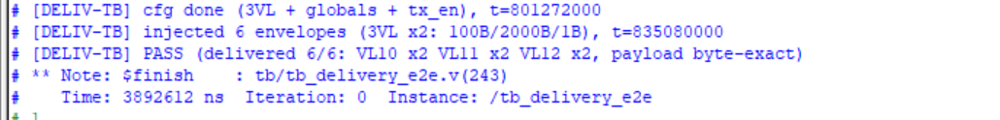
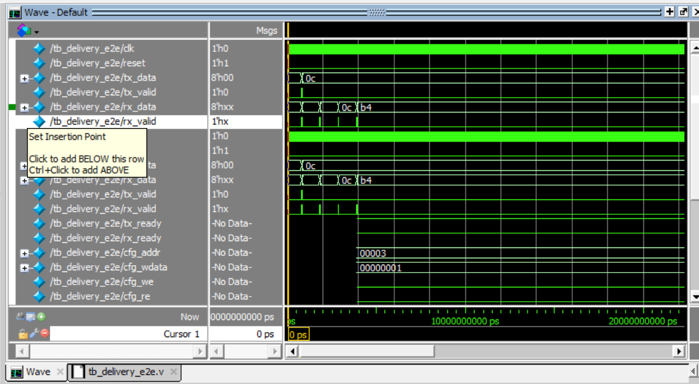
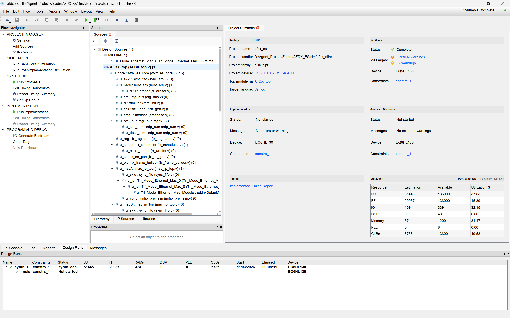

# AFDX End System (ARINC 664 Part 7) on eLinx FPGA


A complete **AFDX (Avionics Full-Duplex Switched Ethernet, ARINC 664 Part 7) end system** implemented in Verilog-2001 on the eLinx domestic FPGA toolchain (device EQ6HL130), delivered and verified entirely in simulation. Single-author entry for the 2026 National Undergraduate Embedded Chip & System Design Competition, FPGA track.

> Keywords: **deterministic · high-integrity · dual-network redundancy**

## Highlights

- **Full data plane**: application-port message interface (VLID + payload envelope), per-VL queuing, BAG traffic shaping, Ethernet/IP/UDP framing, automatic IP fragmentation, dual-network (A/B) redundant transmission.
- **Reception**: frame parsing, 4096-entry VL lookup, integrity checking (IC), redundancy management (RM) with SkewMax window, fragment reassembly.
- **Configurable**: 128 transmit VLs / 4096 receive VLs via a register-mapped configuration bus, with illegal-configuration rejection at the bus layer.
- **Verification-driven**: an independent Python reference model generates golden frames; a checker re-computes FCS, IP checksums, sequence numbers, fragmentation geometry and BAG spacing — no eyeballing waveforms.
- **Post-synthesis simulation passed** on the full (normal-version) netlist after root-causing a three-layer tool-flow mismatch (netlist default-value omission vs. simulation primitive models, plus MAC IP initialization time scale) — fixed on netlist copies only, **zero RTL changes**.

## Architecture

```
Layer 1  Application port   AFDX_top (competition template shell; message in/out, config pins)
Layer 2  Protocol core      afdx_es_core
             TX: host_arb -> buf_mgr -> tx_regulator -> tx_scheduler -> tx_frame_builder -> mac_tx
             RX: mac_rx -> rx_parser -> rx_vl_lookup -> rx_integrity -> rx_redundancy -> rx_reassembly
             Common: cfg_bus / timebase / stats / ram_init
Layer 3  MAC                Tri_Mode_Ethernet_Mac IP x2 (networks A and B)
Layer 4  Line               GMII x2 (125 MHz, 8-bit, gigabit)
```

Single clock domain at 125 MHz. Transmit buffering uses message-level descriptors (one queue slot per message, fragments generated on dequeue, one per BAG), so arbitrarily long messages do not consume extra queue resources.

## Measured results

| Item | Target | Measured | Verdict |
|---|---|---|---|
| Payload throughput | 100 Mbps | 130/130 delivered; 93.80 Mbps aggregate | Partially met (dual accounting in report) |
| Single-frame latency | < 1–2 ms | first byte 3.5 µs; ≈2.04 ms end-to-end model | Met |
| Fragmentation / reassembly | required | 2000 B (2 frags), 8000 B (6 frags) delivered | Met |
| 128-VL full load | full delivery | 4730/6400 (74%) | **Not met** — serial RX engine capacity bound |
| Regression | — | 24/24 units pass; ledger 43 pass / 1 not met / 9 not tested | As recorded |
| Synthesis (eLinx) | 0 errors | 0 errors, LUT 51,445, FF 20,937 | Met |
| Post-synthesis sim | main flows | full netlist short set 3/3, payload byte-exact | Met |

Full data, including everything that did **not** meet spec, is in `doc/08` (test report, in Chinese).

## Screenshots

Delivery test in Questa — 6/6 messages delivered, payload byte-exact:



Waveform (TX/RX application port):



eLinx synthesis summary (0 errors, EQ6HL130):



## Repository layout

| Path | Contents |
|---|---|
| `rtl/` | 32 Verilog modules (top, core, TX chain, RX chain, MAC adapters, primitives) |
| `tb/` | 20 testbenches (unit, path, delivery, micro-probe) |
| `scripts/` | regression / demo / post-synthesis run scripts |
| `sim/` | eLinx project, bypass-variant project, post-synthesis adaptation scripts & records |
| `doc/` | design, module, test and process documents (Chinese) |

## Quick start

```bash
# Full RTL regression (24 units, Icarus Verilog)
bash scripts/regress.sh

# Delivery-form end-to-end demo (6 messages, byte-exact check)
bash scripts/run_delivery_e2e.sh
```

## Documentation

- `doc/02` — overall design + protocol-mechanism notes (VL, SN/IC, RM, BAG, fragmentation)
- `doc/10` — module design notes (all 31 modules)
- `doc/08` — test report: ledger, performance data, post-synthesis simulation full record
- `doc/09` — build process and key events

## Known limitations

- 128-VL full-load delivery reaches 74% (serial receive engine is the capacity bound; parallelizing it is the identified fix).
- Management plane (SNMP / ARINC 615A / RTC) is not implemented; the delivery is the data plane.
- Timing constraints were not closed (no STA); the device flow only required synthesis to pass.
- 9 ledger items remain untested; each is listed as such in the test report.

## License

MIT
